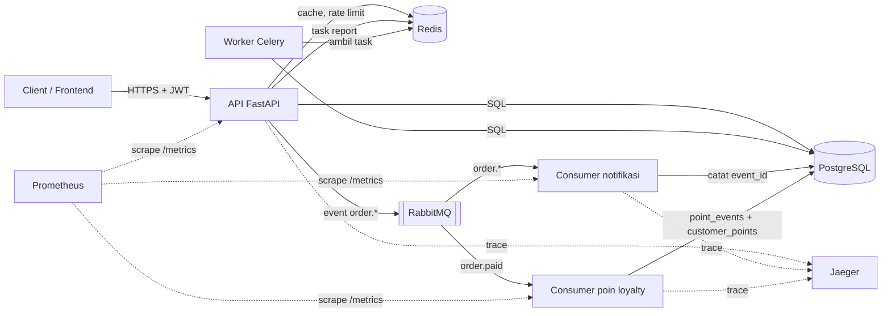

# Arsitektur Order API

## Komponen



| Komponen | Tanggung jawab |
|---|---|
| API | Menerima request, cek token JWT dan scope RBAC, rate limit, menjalankan use case |
| Worker Celery | Membuat report penjualan di background |
| Consumer notifikasi | Mengirim notifikasi dari event `order.*`, retry + DLQ, idempotent lewat `event_id` |
| Consumer poin loyalty | Menambah poin customer (1 poin / Rp10.000) dari event `order.paid`, idempotent dalam satu transaksi DB |
| PostgreSQL | Data produk, order, voucher, user, poin loyalty (`customer_points`, `point_events`), dan log notifikasi |
| Redis | Cache produk & best-sellers (`v1:products:best-sellers`) dengan lock anti-stampede (`lock:<key>`), sliding window rate limit, counter login gagal (`login-fail:<email>`), dan broker Celery |
| Prometheus | Mengambil `/metrics` API dan kedua consumer, mengevaluasi alert SLO, event gagal terkirim, DLQ, dan brute force login (`prometheus/alerts.yml`) |
| RabbitMQ | Exchange topic `orders` (`order.placed`, `order.paid`, `order.cancelled`) beserta retry queue dan DLQ |

## Layer kode

```
app/
  domain/          aturan bisnis: Order, Product, Voucher, Money, DiscountPolicy, User (tanpa library luar)
  application/     use case dan port: OrderService, ProductService, VoucherService, PointsService, AuthService, NotificationService
  infrastructure/  adapter: SQLAlchemy, UnitOfWork, Redis, RabbitMQ, JWT, Argon2, logging JSON, metrics Prometheus, OpenTelemetry
  api/             FastAPI: router, schema Pydantic, dependency injection, rate limit, error handler global
  worker/          Celery (report penjualan)
  consumers/       consumer RabbitMQ (notification_consumer, points_consumer)
```

Dependency hanya mengarah ke dalam: `api` dan `infrastructure` boleh memakai `application` dan `domain`,
tetapi `domain` tidak tahu FastAPI, SQLAlchemy, Redis, maupun RabbitMQ.

## Alur: membuat dan membayar order

1. Client mengirim `POST /orders` (opsional `voucher_code`) dengan header `Authorization: Bearer <token>`
2. `rate_limit` memeriksa kuota request per IP di Redis, lalu `get_current_user` memverifikasi JWT dan scope `orders:write`
3. `OrderService.place_order` mengunci baris produk (urut id) dan voucher (`SELECT ... FOR UPDATE`), mengurangi stok, memotong kuota voucher (`Voucher.redeem`), menghitung diskon tipe customer + voucher, dan menyimpan order dalam satu transaksi (`SqlAlchemyUnitOfWork`). Order bersamaan yang memakai baris sama menunggu bergantian (ADR 0006)
4. Setelah commit, cache produk yang berubah dihapus dan event `order.placed` dikirim ke exchange `orders`
5. Saat client memanggil `POST /orders/{id}/pay`, status order berubah menjadi `paid`, Unit of Work menghapus cache `v1:products:best-sellers`, dan event `order.paid` dikirim ke RabbitMQ
6. Consumer notifikasi dan consumer poin loyalty sama-sama menerima `order.paid` di queue masing-masing, melanjutkan span trace OpenTelemetry, dan memproses secara idempotent

## Alur: login

1. `POST /auth/token` (form `username` = email, `password`). `AuthService.login` bertanya ke `LoginAttemptLimiter`: sudah diblokir? Jika ya, `429` + `Retry-After` tanpa memeriksa password
2. Password salah atau email tidak ada: hitungan gagal naik (`login_failures_total`). Berhasil: hitungan direset dan JWT (HS256, ada `exp`) dibuat dengan scope sesuai role
3. Request berikutnya membawa `Authorization: Bearer <token>`. `get_current_user` membaca token dan mengecek scope tiap endpoint (RBAC)
